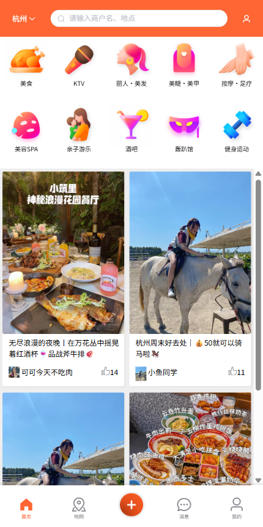
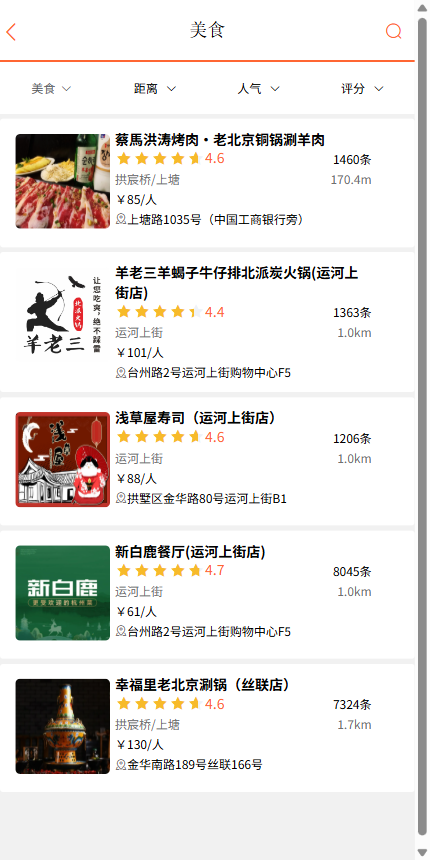
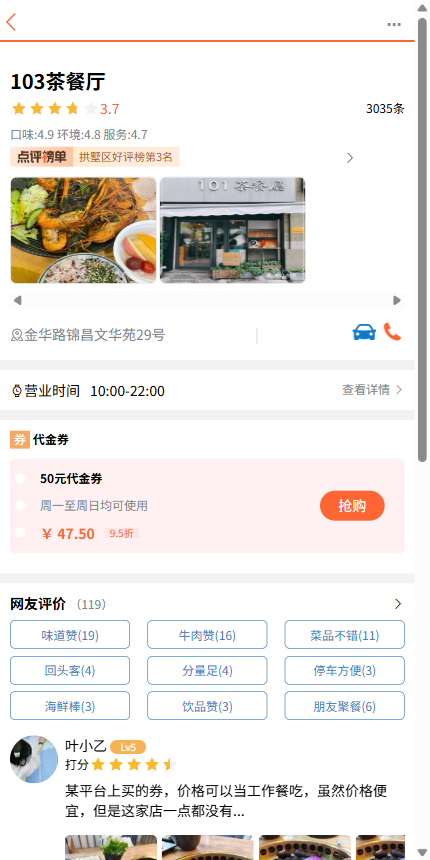
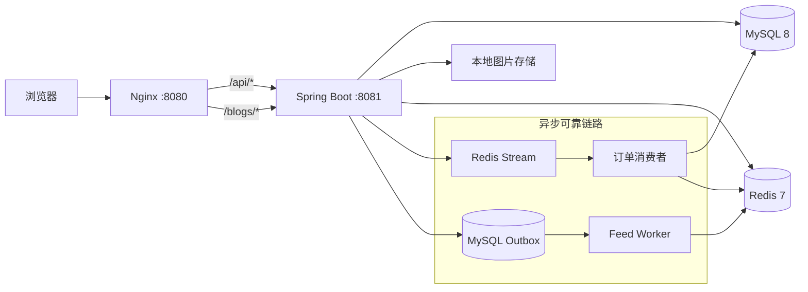
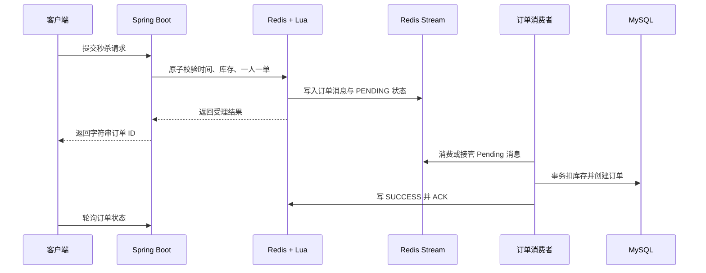

<div align="center">

# CitySeek

基于 Spring Boot、MySQL 与 Redis 构建的本地生活点评平台，聚焦高并发秒杀、可靠消息投递与缓存一致性。

[](https://www.oracle.com/java/technologies/javase/jdk17-archive-downloads.html)
[](https://spring.io/projects/spring-boot)
[](https://www.mysql.com/)
[](https://redis.io/)
[](https://v2.vuejs.org/)
[](LICENSE)

[项目亮点](#项目亮点) · [系统架构](#系统架构) · [快速启动](#快速启动) · [测试与压测](#测试与压测) · [核心接口](#核心接口)

</div>

<p align="center">
  
  
  
</p>

<p align="center"><sub>首页推荐 · 附近商铺 · 商铺详情与优惠券</sub></p>

## 项目简介

CitySeek 是一个前后端完整的本地生活项目，覆盖商铺检索、达人探店、关注 Feed、用户签到、图片上传和优惠券秒杀等业务。项目不仅实现业务功能，还围绕并发一致性、故障恢复、权限边界、可观测性和自动化测试进行了工程化改造。

它适合作为以下方向的学习或作品集项目：

- Redis 数据结构与典型业务场景实践；
- 高并发秒杀、异步下单和最终一致性设计；
- MySQL Outbox、租约与 fencing token 可靠投递；
- Spring Boot 3 项目的测试、监控与容器化交付。

## 项目亮点

| 方向 | 实现 |
| --- | --- |
| 高并发秒杀 | Lua 原子预检与扣库存、Redis Stream 异步削峰、Redisson 用户锁、MySQL 条件扣库存与唯一索引 |
| 故障恢复 | `XAUTOCLAIM` 自动接管 Pending、有限重试、幂等补偿、有界 DLQ、`PENDING/SUCCESS/FAILED` 状态查询 |
| Feed 可靠投递 | Blog 与 Outbox 同事务写入，Worker 使用租约、claim token、分页与 Redis Pipeline 投递 |
| 缓存与检索 | 缓存空值防穿透，互斥锁/逻辑过期防击穿，Redis GEO 5 公里范围检索及全量对账 |
| 安全与权限 | 默认鉴权、显式公开接口、简单 RBAC、验证码频控与原子消费、上传文件所有权校验 |
| 工程质量 | Docker Compose 一键部署、Testcontainers 真实依赖测试、Prometheus 指标、健康检查与 HTTP 压测 |

## 系统架构



### 秒杀下单链路



秒杀请求成功只代表系统已经受理，最终结果由状态查询接口返回。订单 ID 在 JSON 中按字符串输出，避免 JavaScript 对 64 位整数的精度丢失。

### 一致性与恢复策略

| 风险 | 处理方式 |
| --- | --- |
| Redis 并发超卖 | Lua 将时间校验、扣库存、用户标记和消息投递放在一次原子执行中 |
| 数据库超卖 | `stock > 0` 条件更新 |
| 同一用户重复下单 | Redis 用户集合 + Redisson 用户锁 + MySQL 唯一索引三层保障 |
| 消费者宕机 | 周期性 `XAUTOCLAIM` 接管超时 Pending 消息 |
| 消息持续失败 | 最多重试 3 次，Lua 幂等补偿 Redis 库存与购买标记，并写入 DLQ |
| 补偿时订单已落库 | 以数据库记录为准修正为 `SUCCESS`，不错误回补库存 |
| Blog 与 Feed 双写不一致 | MySQL Outbox 与 Blog 同事务提交，后台按租约异步投递 |
| Worker 重复投递 | Feed 以 blogId 作为 ZSet member，重复 `ZADD` 保持幂等 |

## 功能矩阵

- **用户系统**：手机验证码登录、Token 滑动续期、退出登录、资料编辑、Bitmap 签到统计；
- **商铺服务**：分类/名称查询、缓存详情、GEO 附近检索、管理员维护与 GEO 对账；
- **探店社区**：发布笔记、点赞排行、评论、关注/取关、共同关注、Feed 滚动分页；
- **优惠券**：普通券、秒杀券、异步下单、订单状态恢复查询；
- **图片服务**：类型与内容校验、UUID 分目录、所有权/绑定状态、路径穿越防护；
- **运维能力**：健康检查、Prometheus 指标、Outbox 失败查询与人工重放。

## 技术栈

| 分类 | 技术 |
| --- | --- |
| 后端 | Java 17、Spring Boot 3.4.4、Spring MVC、Jakarta Validation |
| 数据访问 | MyBatis-Plus 3.5.7、MySQL 8 |
| Redis | Spring Data Redis、Redisson 3.40.2、Lua、String/Hash/Set/ZSet/Bitmap/GEO/Stream |
| 可靠性 | Redis Stream、MySQL Outbox、租约、fencing token、DLQ |
| 可观测性 | Spring Boot Actuator、Micrometer、Prometheus |
| 前端 | Vue 2、Element UI、Axios、Nginx |
| 测试 | JUnit 5、Mockito、Testcontainers、真实 HTTP 并发压测 |
| 部署 | Docker、Docker Compose、Nginx |

## 快速启动

### Docker Compose（推荐）

环境要求：Docker Engine 24+、Docker Compose v2。

```bash
git clone https://github.com/mhn0207/CitySeek.git
cd CitySeek
cp .env.example .env
docker compose up -d --build
```

Windows PowerShell 复制环境变量文件：

```powershell
Copy-Item .env.example .env
docker compose up -d --build
```

启动后访问：

| 服务 | 地址 |
| --- | --- |
| Web 前端 | <http://localhost:8080> |
| 后端 API | <http://127.0.0.1:8081> |
| 健康检查 | <http://127.0.0.1:8081/actuator/health> |

```bash
# 查看容器状态
docker compose ps

# 查看应用日志
docker compose logs -f app

# 停止服务但保留数据卷
docker compose down
```

> 首次运行前请修改 `.env` 中的数据库和 Redis 密码。执行 `docker compose down -v` 会永久删除数据库、Redis 和上传图片的数据卷，请谨慎使用。

### 本地开发

<details>
<summary>使用本机 JDK、MySQL、Redis 与 Nginx 启动</summary>

1. 准备 JDK 17、Maven 3.9+、MySQL 8、Redis 6.2+ 和 Nginx；
2. 创建 `cityseek` 数据库并导入 [`cityseek.sql`](src/main/resources/db/cityseek.sql)；
3. 配置连接信息并启动后端；

```powershell
$env:DB_URL = "jdbc:mysql://127.0.0.1:3306/cityseek?useSSL=false&serverTimezone=Asia/Shanghai&allowPublicKeyRetrieval=true"
$env:DB_USERNAME = "root"
$env:DB_PASSWORD = "your-password"
$env:REDIS_HOST = "127.0.0.1"
$env:REDIS_PORT = "6379"
mvn spring-boot:run
```

4. 将 [`web/nginx.conf.example`](web/nginx.conf.example) 中的 `__CITYSEEK_WEB_ROOT__` 替换为 `web/` 的绝对路径；
5. 启动 Nginx 并访问 <http://localhost:8080>。

完整前端说明见 [`web/README.md`](web/README.md)。已有数据库应按顺序执行 [`db/migration`](src/main/resources/db/migration/) 中的增量脚本，不要重新导入完整初始化 SQL。

</details>

### 获取本地验证码

项目未接入真实短信平台。开发环境可将 `.env` 中的日志级别改为：

```dotenv
APP_LOG_LEVEL=debug
```

请求验证码后，通过 `docker compose logs app` 查看验证码。生产环境必须接入真实短信服务，并禁止在日志中输出验证码。

## 配置说明

所有敏感配置都可以通过环境变量覆盖，模板见 [`.env.example`](.env.example)。常用配置如下：

| 环境变量 | 默认值 | 说明 |
| --- | --- | --- |
| `SERVER_PORT` | `8081` | 后端端口 |
| `DB_URL` | 本机 `3306/cityseek` | JDBC 地址 |
| `DB_USERNAME` / `DB_PASSWORD` | `root` / 空 | MySQL 凭据 |
| `REDIS_HOST` / `REDIS_PORT` | `127.0.0.1` / `6379` | Redis 地址 |
| `REDIS_PASSWORD` | 空 | Redis 密码 |
| `IMAGE_UPLOAD_DIR` | `./data/images` | 图片存储目录 |
| `REDIS_STREAM_CONSUMER` | `cityseek-consumer` | Stream 消费者名称，多实例必须唯一 |
| `REDIS_PENDING_MIN_IDLE` | `30s` | Pending 可被接管前的最小空闲时间 |
| `REDIS_DLQ_MAX_LENGTH` | `10000` | 订单 DLQ 近似最大长度 |
| `FEED_OUTBOX_ENABLED` | `true` | 是否启用 Feed Outbox Worker |
| `FEED_OUTBOX_LEASE_DURATION` | `30s` | Outbox 处理租约 |
| `APP_LOG_LEVEL` | `info` | 项目日志级别 |

更多参数见 [`application.yaml`](src/main/resources/application.yaml)。

## 核心接口

接口统一返回：

```json
{
  "success": true,
  "errorMsg": null,
  "data": {},
  "total": null
}
```

登录成功后，受保护接口需要携带 `Authorization: Bearer <token>`。为兼容当前静态前端，也支持直接传 Token。

<details>
<summary>展开主要 API</summary>

| 方法 | 路径 | 权限 | 说明 |
| --- | --- | --- | --- |
| POST | `/user/code?phone=...` | 公开 | 获取验证码 |
| POST | `/user/login` | 公开 | 验证码登录 |
| GET | `/user/me` | 登录 | 当前用户 |
| POST | `/user/sign` | 登录 | 当日签到 |
| GET | `/shop/{id}` | 公开 | 商铺详情 |
| GET | `/shop/of/type` | 公开 | 分类/GEO 分页查询 |
| POST | `/shop/geo/reconcile` | 管理员 | 重建商铺 GEO |
| GET | `/blog/hot` | 公开 | 热门笔记 |
| POST | `/blog` | 登录 | 发布笔记 |
| GET | `/blog/of/follow` | 登录 | 关注 Feed 滚动分页 |
| POST | `/voucher/seckill` | 管理员 | 新增秒杀券 |
| POST | `/voucher-order/seckill/{id}` | 登录 | 提交秒杀订单 |
| GET | `/voucher-order/status/{id}` | 登录 | 查询订单处理状态 |
| POST | `/upload/blog` | 登录 | 上传笔记图片 |
| GET | `/admin/outbox?status=FAILED` | 管理员 | 查询失败 Outbox 事件 |
| POST | `/admin/outbox/{id}/replay` | 管理员 | 重放 Outbox 事件 |

</details>

未标记 `@PublicEndpoint` 的控制器方法默认要求登录；管理接口额外通过 `@RequireRole(ADMIN)` 限制权限。

## Redis 数据设计

| Key | 类型 | 用途 |
| --- | --- | --- |
| `login:code:{phone}` | String | 登录验证码 |
| `login:token:{token}` | Hash | 用户会话 |
| `cache:shop:{id}` | String | 商铺缓存 |
| `shop:geo:{typeId}` | GEO | 分类商铺坐标 |
| `blog:liked:{blogId}` | ZSet | 笔记点赞用户与时间 |
| `feed:{userId}` | ZSet | 用户关注动态 |
| `sign:{userId}:{yyyyMM}` | Bitmap | 月度签到 |
| `seckill:stock:{voucherId}` | String | 秒杀库存 |
| `seckill:order:{voucherId}` | Set | 已下单用户 |
| `seckill:order:status:{orderId}` | Hash | 订单受理状态 |
| `stream.orders` | Stream | 秒杀订单消息 |
| `stream.orders.dlq` | Stream | 失败订单死信消息 |

应用启动时会补齐关注关系、秒杀时间、缺失库存与历史下单标记。GEO 由管理员对账接口分页、Pipeline 重建，避免启动线程逐条全量写入。

## 测试与压测

### 自动化测试

```bash
mvn test
```

测试覆盖请求校验、权限拦截、缓存逻辑、图片所有权、GEO 类型迁移、Feed Outbox 幂等与租约 fencing、秒杀可靠性等场景。集成测试使用 Testcontainers 启动 MySQL 8.0.36 和 Redis 7.2。

当前本机回归结果：**27 tests，0 failures，0 errors，0 skipped**。Docker 不可用时容器测试会跳过，因此验收时需要同时检查 `Skipped` 数量。

单独执行秒杀可靠性测试：

```bash
mvn -Dtest=VoucherOrderReliabilityIntegrationTest test
```

### HTTP 并发压测

```bash
mvn -Dtest=VoucherSeckillLoadIT \
  -Dload.requests=500 \
  -Dload.stock=200 \
  -Dload.concurrency=100 test
```

2026-08-08，本机 Docker Desktop 单实例阶梯压测结果：

| 并发 | 请求 / 库存 | 结果 | 吞吐量 | P95 延迟 | HTTP 成功率 |
| ---: | ---: | --- | ---: | ---: | ---: |
| 100 | 500 / 200 | PASS | 133.29 req/s | 3.23 s | 100.00% |
| 200 | 1000 / 400 | PASS | 164.64 req/s | 5.10 s | 100.00% |
| 500 | 2000 / 400 | PASS | 225.09 req/s | 7.30 s | 100.00% |
| 500 | 2000 / 800 | 30 秒内未排空 | — | — | — |

通过档均未超卖，受理数、数据库订单数、成功状态数与 Redis/MySQL 库存一致。500 并发、800 库存档在请求结束后 30 秒内未完成异步落库，说明单实例的消费积压和尾延迟已成为容量边界，但不能据此判断为数据丢失。

压测报告会写入 `target/seckill-load-test-report.md`。详细口径、复现方法和边界说明见 [`docs/SECKILL_LOAD_TEST.md`](docs/SECKILL_LOAD_TEST.md)。本机数据仅用于回归基线，不代表生产容量承诺。

## 可观测性

管理员可以访问 `/actuator/prometheus`。项目采集的核心指标包括：

- 秒杀请求、受理、拒绝、落库、重试、补偿和 DLQ 数量；
- Redis Stream 长度、Pending 数量、最老 Pending 年龄与消费者 lag；
- Feed Outbox 投递成功、重试和最终失败数量；
- 自定义健康检查对 Stream 积压阈值进行告警。

## 项目结构

```text
CitySeek/
├─ src/main/java/com/cityseek/
│  ├─ controller/        # HTTP 接口
│  ├─ service/impl/      # 核心业务
│  ├─ feed/              # Outbox Worker 与 Feed 投递
│  ├─ metrics/           # 业务指标与健康检查
│  ├─ security/          # RBAC
│  └─ utils/             # 缓存、锁、ID、拦截器
├─ src/main/resources/
│  ├─ db/                # 初始化 SQL 与迁移脚本
│  ├─ mapper/            # MyBatis XML
│  └─ *.lua              # 登录、秒杀、补偿、解锁脚本
├─ src/test/             # 单元、集成与压测代码
├─ web/                  # Vue 2 静态前端与 Nginx 配置
├─ docs/                 # 压测与改进记录
├─ compose.yaml
├─ Dockerfile
└─ pom.xml
```

## 已知边界

- 验证码目前仅写入开发日志，未接入真实短信服务；
- 前端为 Vue 2 静态页面，适合演示与联调，尚未迁移到现代构建工具链；
- 图片默认存储在本地目录，生产环境建议替换为对象存储；
- 主订单 Stream 不自动裁剪，生产部署需要根据 Pending/ACK 水位制定安全清理策略；
- 压测数据来自单机开发环境，正式容量规划需要结合目标硬件重新测试。

进一步的实现记录和演进建议见 [`docs/PROJECT_IMPROVEMENT_PLAN.md`](docs/PROJECT_IMPROVEMENT_PLAN.md)。

## License

本项目采用 [MIT License](LICENSE)。
