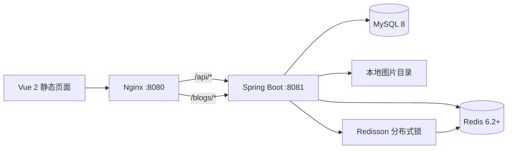
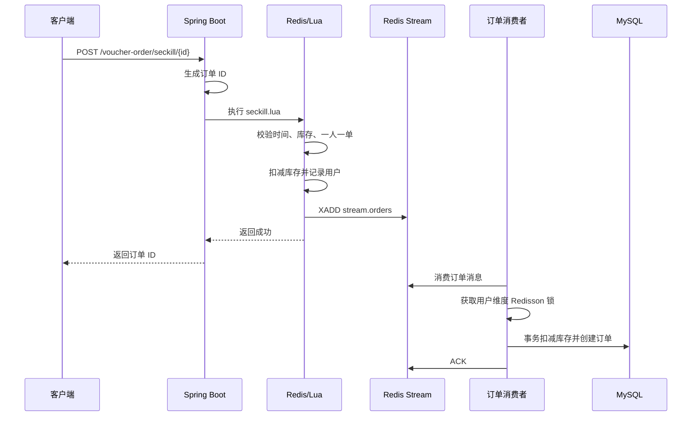

# CitySeek

一个基于 Spring Boot、MySQL 与 Redis 的本地生活点评和优惠券秒杀项目。项目覆盖商铺查询、探店笔记、关注动态、用户签到、图片上传及高并发秒杀等场景，重点展示 Redis 在缓存、分布式锁、地理位置、消息流和原子脚本中的应用。

## 项目亮点

- 升级到 Java 17、Spring Boot 3 和 MyBatis-Plus 3，并将数据库、Redis、上传目录和消费者参数改为环境变量配置；
- 统一重命名为 CitySeek，将前端静态源码纳入同一仓库，修复资料编辑、图片上传和删除等前后端联调流程；
- 将接口鉴权改为默认保护、显式公开，增加验证码频控与 Lua 原子消费、Token 续期、退出登录和用户资料更新；
- 重构秒杀下单链路，增加订单受理状态、`XAUTOCLAIM` Pending 接管、幂等消费、有限重试、Lua 原子补偿和有界死信队列；
- 增加数据库唯一索引、条件扣库存以及真实 MySQL/Redis Testcontainers 可靠性测试和可调参数 HTTP 压测；
- 补充统一异常处理、输入校验、上传路径规范化，以及完整的架构、接口、Redis Key 和测试文档。

项目重点展示并发一致性、故障恢复、可测试性和工程交付能力。

## 项目架构



仓库目录：

```text
cityseek/
├─ src/main/java/com/cityseek/
│  ├─ config/                            # MVC、MyBatis、Redis、异常处理配置
│  ├─ controller/                        # HTTP 接口
│  ├─ service/impl/                      # 核心业务实现
│  ├─ mapper/                            # MyBatis-Plus Mapper
│  ├─ entity/                            # 数据库实体
│  ├─ dto/                               # 请求和响应模型
│  └─ utils/                             # 缓存、锁、ID、拦截器等工具
├─ src/main/resources/
│  ├─ db/cityseek.sql                    # 数据库结构与演示数据
│  ├─ mapper/VoucherMapper.xml
│  ├─ login-code-consume.lua
│  ├─ seckill.lua
│  ├─ seckill-compensate.lua
│  └─ unlock.lua
├─ src/test/java/com/cityseek/            # 单元测试、容器测试与压测
├─ web/                                   # Vue 2 + Element UI 静态页面
│  ├─ nginx.conf.example                  # 静态资源与反向代理配置示例
│  └─ README.md                           # 前端运行说明
├─ docs/                                  # 压测记录与后续改造方案
│  ├─ SECKILL_LOAD_TEST.md
│  └─ PROJECT_IMPROVEMENT_PLAN.md         # 规划中，清单完成前不代表已经实现
├─ pom.xml
└─ README.md
```

## 技术栈

- Java 17
- Spring Boot 3.4.4
- MyBatis-Plus 3.5.7
- MySQL 8
- Redis（String、Hash、Set、ZSet、Bitmap、GEO、Stream）
- Redisson 3.40.2
- Lua
- Hutool、Lombok、Jakarta Validation
- Vue 2、Element UI、Axios、Nginx
- JUnit 5、Mockito

## 功能概览

### 用户与鉴权

- 手机验证码登录，新手机号自动创建用户
- Redis 原子校验并消费验证码，防止并发重放
- Token 会话、滑动续期和退出登录
- 用户资料编辑
- Redis Bitmap 用户签到及连续签到统计

### 商铺与缓存

- 商铺详情、类型和名称查询
- 商铺新增、更新及缓存失效
- 缓存空值解决缓存穿透
- `CacheClient` 同时提供互斥锁和逻辑过期两种缓存击穿处理方案
- Redis GEO 查询 5 公里内商铺并按距离分页

当前商铺详情接口实际启用的是缓存穿透方案；互斥锁和逻辑过期实现保留在 `CacheClient` 中，可按业务需要切换。

### 笔记与社交

- 发布、查询和点赞探店笔记
- Redis ZSet 维护点赞用户及点赞时间
- 关注、取消关注和共同关注
- 发布笔记时推送到粉丝 Feed
- 基于时间戳与偏移量的 Feed 滚动分页
- 笔记评论查询与发布

### 优惠券秒杀

- Redis Lua 原子校验活动时间、库存和一人一单
- Redis 生成全局趋势递增订单 ID
- Redis Stream 异步削峰下单
- Redisson 用户维度分布式锁
- MySQL 事务扣减库存并创建订单
- 数据库唯一索引提供最终幂等保障
- `PENDING/SUCCESS/FAILED` 订单受理状态查询
- 周期性 `XAUTOCLAIM` 接管宕机消费者的 Pending 消息
- 连续失败 3 次后由 Lua 幂等补偿库存和购买标记，并写入有界 DLQ
- DLQ 设置长度上限，订单状态设置 TTL；主 Stream 不自动裁剪，以免删除未 ACK 的 Pending 消息

### 图片上传

- 支持 `jpg`、`jpeg`、`png`、`webp`、`gif`
- 单次上传和请求最大 5 MB
- UUID 分目录存储
- 路径规范化校验，避免目录穿越
- 后端通过 `/blogs/**` 直接暴露上传图片

## 环境要求

- JDK 17+
- Maven 3.9+
- MySQL 8+
- Redis 6.2+（秒杀功能需要 Redis Stream 消费组）
- Nginx 1.18（仅完整前端联调需要；不纳入 `cityseek-server` 源码仓库）

## 快速启动

### 1. 初始化 MySQL

创建数据库并导入脚本：

```sql
CREATE DATABASE cityseek
    DEFAULT CHARACTER SET utf8mb4
    COLLATE utf8mb4_general_ci;
```

```bash
mysql -u root -p cityseek < src/main/resources/db/cityseek.sql
```

脚本会创建以下数据表：

| 表 | 用途 |
| --- | --- |
| `tb_user` | 用户基础信息 |
| `tb_user_info` | 用户详情 |
| `tb_shop` | 商铺 |
| `tb_shop_type` | 商铺类型 |
| `tb_blog` | 探店笔记 |
| `tb_blog_comments` | 笔记评论 |
| `tb_follow` | 关注关系 |
| `tb_voucher` | 优惠券 |
| `tb_seckill_voucher` | 秒杀库存和时间 |
| `tb_voucher_order` | 优惠券订单 |

### 2. 启动 Redis

默认连接：

```text
127.0.0.1:6379
database: 0
password: 空
```

### 3. 配置后端

项目支持通过环境变量覆盖默认配置。在 PowerShell 中可以这样设置：

```powershell
$env:DB_USERNAME = "root"
$env:DB_PASSWORD = "your-password"
$env:REDIS_HOST = "127.0.0.1"
$env:REDIS_PORT = "6379"
```

完整配置项：

| 环境变量 | 默认值 | 用途 |
| --- | --- | --- |
| `SERVER_PORT` | `8081` | 后端 HTTP 端口 |
| `DB_URL` | `jdbc:mysql://127.0.0.1:3306/cityseek?...` | JDBC 地址 |
| `DB_USERNAME` | `root` | MySQL 用户名 |
| `DB_PASSWORD` | 空 | MySQL 密码 |
| `REDIS_HOST` | `127.0.0.1` | Redis 地址 |
| `REDIS_PORT` | `6379` | Redis 端口 |
| `REDIS_PASSWORD` | 空 | Redis 密码 |
| `REDIS_DATABASE` | `0` | Redis DB |
| `IMAGE_UPLOAD_DIR` | `./data/images` | 上传图片存储目录 |
| `REDIS_INITIALIZE_CACHE` | `true` | 启动时初始化 Redis 派生数据 |
| `REDIS_STREAM_CONSUMER` | `cityseek-consumer` | Stream 消费者名称 |
| `REDIS_PENDING_MIN_IDLE` | `30s` | Pending 消息允许被其他消费者接管前的最小空闲时间 |
| `REDIS_PENDING_RECOVERY_INTERVAL` | `5s` | Pending 恢复扫描间隔 |
| `REDIS_PENDING_BATCH_SIZE` | `20` | 每批 `XAUTOCLAIM` 接管的消息数量 |
| `REDIS_DLQ_MAX_LENGTH` | `10000` | 秒杀订单死信 Stream 的近似最大长度 |
| `APP_LOG_LEVEL` | `info` | `com.cityseek` 日志级别 |

多实例部署时，每个实例的 `REDIS_STREAM_CONSUMER` 必须不同。

### 4. 启动后端

在仓库根目录执行：

```bash
mvn spring-boot:run
```

默认后端地址：

```text
http://localhost:8081
```

### 5. 启动前端

前端源码已经包含在 `web/`。参考 [`web/README.md`](web/README.md)，使用本机 Nginx
提供静态页面，并应用 [`web/nginx.conf.example`](web/nginx.conf.example) 中的反向代理配置。

访问：

```text
http://localhost:8080
```

Nginx 会将 `/api/*` 去掉 `/api` 前缀后转发至 `http://127.0.0.1:8081`，并将
`/blogs/*` 转发到后端上传图片目录。Nginx 二进制、运行日志和 PID 不属于
`cityseek-server` 源码仓库；可以使用工作区中的外置 Nginx，或自行安装兼容版本。

## 登录与鉴权

### 获取验证码

```http
POST /user/code?phone=13800138000
```

项目没有接入真实短信服务。验证码只会以 `DEBUG` 日志输出，本地调试时可以设置：

```powershell
$env:APP_LOG_LEVEL = "debug"
```

生产环境应替换为真实短信服务，并禁止在日志中输出验证码。

### 登录

```http
POST /user/login
Content-Type: application/json

{
  "phone": "13800138000",
  "code": "123456"
}
```

登录成功后，响应 `data` 字段为 Token。受保护接口需要携带：

```http
Authorization: Bearer <token>
```

为兼容当前静态前端，也支持直接把 Token 放入 `Authorization` 请求头。

未标记 `@PublicEndpoint` 的控制器方法默认需要登录。用户会话存储在 Redis Hash 中，默认有效期为 30 分钟，每次有效访问会刷新过期时间。

## 统一响应

接口使用统一响应结构：

```json
{
  "success": true,
  "errorMsg": null,
  "data": {},
  "total": null
}
```

业务失败时通常返回：

```json
{
  "success": false,
  "errorMsg": "错误信息"
}
```

未登录访问受保护接口时，HTTP 状态码为 `401`。

## 主要接口

### 用户

| 方法 | 路径 | 鉴权 | 说明 |
| --- | --- | --- | --- |
| POST | `/user/code?phone=...` | 公开 | 获取验证码 |
| POST | `/user/login` | 公开 | 验证码登录 |
| POST | `/user/logout` | 登录 | 退出登录 |
| GET | `/user/me` | 登录 | 当前用户 |
| PUT | `/user/profile` | 登录 | 修改用户资料 |
| GET | `/user/{id}` | 公开 | 查询用户 |
| GET | `/user/info/{id}` | 公开 | 查询用户详情 |
| POST | `/user/sign` | 登录 | 当日签到 |
| GET | `/user/sign/count` | 登录 | 连续签到天数 |

### 商铺与优惠券

| 方法 | 路径 | 鉴权 | 说明 |
| --- | --- | --- | --- |
| GET | `/shop/{id}` | 公开 | 商铺详情 |
| GET | `/shop/of/type` | 公开 | 按类型或坐标分页查询 |
| GET | `/shop/of/name` | 公开 | 按名称查询 |
| POST | `/shop` | 登录 | 新增商铺 |
| PUT | `/shop` | 登录 | 更新商铺 |
| GET | `/shop-type/list` | 公开 | 商铺类型列表 |
| GET | `/voucher/list/{shopId}` | 公开 | 商铺优惠券 |
| POST | `/voucher` | 登录 | 新增普通券 |
| POST | `/voucher/seckill` | 登录 | 新增秒杀券 |
| POST | `/voucher-order/seckill/{id}` | 登录 | 秒杀下单 |
| GET | `/voucher-order/status/{id}` | 登录 | 查询当前用户的订单处理状态 |

### 笔记、关注与评论

| 方法 | 路径 | 鉴权 | 说明 |
| --- | --- | --- | --- |
| GET | `/blog/hot?current=1` | 公开 | 热门笔记 |
| GET | `/blog/{id}` | 公开 | 笔记详情 |
| POST | `/blog` | 登录 | 发布笔记 |
| PUT | `/blog/like/{id}` | 登录 | 点赞或取消点赞 |
| GET | `/blog/likes/{id}` | 公开 | 最早点赞的 5 位用户 |
| GET | `/blog/of/me` | 登录 | 当前用户笔记 |
| GET | `/blog/of/user?id=...` | 公开 | 指定用户笔记 |
| GET | `/blog/of/follow` | 登录 | 关注动态滚动分页 |
| PUT | `/follow/{id}/{isFollow}` | 登录 | 关注或取消关注 |
| GET | `/follow/or/not/{id}` | 登录 | 是否已关注 |
| GET | `/follow/common/{id}` | 登录 | 共同关注 |
| GET | `/blog-comments/of/blog` | 公开 | 查询笔记评论 |
| POST | `/blog-comments` | 登录 | 发布评论 |

### 图片

| 方法 | 路径 | 鉴权 | 说明 |
| --- | --- | --- | --- |
| POST | `/upload/blog` | 登录 | 上传笔记图片 |
| DELETE | `/upload/blog?name=...` | 登录 | 删除上传图片 |
| GET | `/blogs/**` | 公开静态资源 | 访问上传图片 |

## Redis 数据设计

| Key | 类型 | 用途 |
| --- | --- | --- |
| `login:code:{phone}` | String | 登录验证码 |
| `login:code:cooldown:{phone}` | String | 验证码发送频控 |
| `login:token:{token}` | Hash | 登录用户会话 |
| `cache:shop:{id}` | String | 商铺 JSON 缓存 |
| `lock:shop:{id}` | String | 商铺缓存重建锁 |
| `shop:geo:{typeId}` | GEO | 分类商铺坐标 |
| `follows:{userId}` | Set | 关注用户集合 |
| `blog:liked:{blogId}` | ZSet | 笔记点赞用户 |
| `feed:{userId}` | ZSet | 用户关注动态 |
| `sign:{userId}:{yyyyMM}` | Bitmap | 月度签到记录 |
| `seckill:stock:{voucherId}` | String | Redis 秒杀库存 |
| `seckill:begin:{voucherId}` | String | 秒杀开始时间 |
| `seckill:end:{voucherId}` | String | 秒杀结束时间 |
| `seckill:order:{voucherId}` | Set | 已下单用户 |
| `seckill:order:status:{orderId}` | Hash | `PENDING/SUCCESS/FAILED` 订单状态 |
| `stream.orders` | Stream | 秒杀订单消息，不自动裁剪 Pending |
| `stream.orders.dlq` | Stream | 有界订单死信消息 |

应用启动时，`RedisDataInitializer` 会从数据库初始化 GEO、关注关系、秒杀时间、缺失的秒杀库存以及历史下单用户集合。秒杀库存使用 `setIfAbsent`，因此 Redis 已有库存时不会被数据库值覆盖。

## 秒杀处理流程



一致性保障：

1. Lua 保证 Redis 中预检、扣库存、标记用户、写入 `PENDING` 状态和投递消息的原子性。
2. Stream 消费组实现异步削峰，消费者启动后会周期性执行 `XAUTOCLAIM` 接管超时 Pending。
3. Redisson 用户锁减少同一用户订单的并发处理。
4. 数据库使用条件更新 `stock > 0` 防止超卖。
5. `tb_voucher_order(user_id, voucher_id)` 唯一索引保证最终幂等。
6. 数据库事务成功后写入 `SUCCESS` 状态并 ACK；查询接口只允许订单所属用户访问。
7. 消费连续失败 3 次时，Lua 原子恢复 Redis 库存、删除购买标记、写入 `FAILED` 和 DLQ，再 ACK 原消息。
8. 补偿脚本按订单状态幂等执行；若数据库订单已经存在，则直接修正为 `SUCCESS`，不会错误回补库存。
9. DLQ 使用近似 `MAXLEN`，订单状态使用 TTL；主 Stream 需监控长度并基于 Pending/ACK 水位安全清理。

## 测试

执行单元测试和真实依赖可靠性测试：

```bash
mvn test
```

其中 `VoucherOrderReliabilityIntegrationTest` 使用 Testcontainers 启动 MySQL 8.0.36 和 Redis 7.2，验证 `XAUTOCLAIM` 接管、并发不超卖以及失败后的 DLQ 补偿。Docker 不可用时容器测试会跳过，测试报告中的 `Skipped` 应作为验收条件检查。

单独执行可靠性测试：

```bash
mvn -Dtest=VoucherOrderReliabilityIntegrationTest test
```

执行可调参数的真实 HTTP 压测：

```bash
mvn -Dtest=VoucherSeckillLoadIT -Dload.requests=500 -Dload.stock=200 -Dload.concurrency=100 test
```

压测报告写入 `target/seckill-load-test-report.md`。本次实测结果和指标口径见 [`docs/SECKILL_LOAD_TEST.md`](docs/SECKILL_LOAD_TEST.md)。

## 生产化建议

- 接入真实短信服务以及发送频控、审计和告警
- 为商铺、优惠券新增等写接口增加管理员权限
- 继续增加 Redis/MySQL 断连、进程强制终止和 Nginx 端到端故障测试
- 增加 Pending、消费延迟、重试和 DLQ 指标监控与告警，并提供受审计的人工重放入口
- 多实例部署时为每个 Stream 消费者配置唯一名称
- 将启动时全量初始化改为可观测的迁移或分批任务
- 增加指标监控、链路追踪和集中日志

详细实施顺序、数据库迁移要求和验收清单见
[`docs/PROJECT_IMPROVEMENT_PLAN.md`](docs/PROJECT_IMPROVEMENT_PLAN.md)。该文档当前是规划，
其中未勾选的能力不应描述为已经实现。
