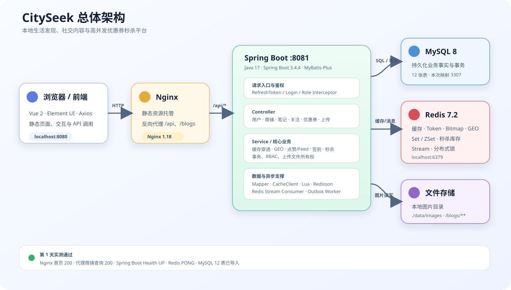
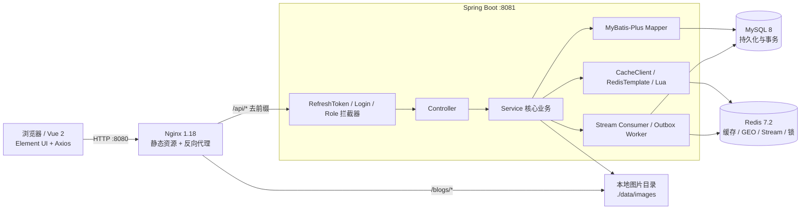

# 第 1 天学习成果：CitySeek 项目总览

日期：2026-08-07

## 1. 启动与运行确认

| 组件 | 本次运行方式 | 状态 | 验证结果 |
| --- | --- | --- | --- |
| 前端 / Nginx | 工作区 Nginx 1.18，端口 `8080` | 正常 | 首页返回 HTTP 200；`/api/shop/1` 返回 HTTP 200 |
| Spring Boot | Java 17，端口 `8081` | 正常 | `/actuator/health` 返回 HTTP 200；`/shop/1` 返回业务数据 |
| MySQL | 隔离 Docker 容器 `cityseek-mysql`，宿主机端口 `3307` | 正常 | MySQL 8.0.36；`cityseek` 库已导入 12 张表 |
| Redis | Docker 容器 `cityseek-redis`，端口 `6379` | 正常 | `PING` 返回 `PONG`；商铺查询后生成 `cache:shop:1` |
| 文件存储 | 后端本地目录 `./data/images` | 配置有效 | 由 Spring Boot 通过 `/blogs/**` 暴露 |

说明：机器上原有 MySQL 8 正在监听 `3306`，但 `root` 空密码认证失败。为不修改原服务，本次使用隔离的 MySQL 容器映射到 `3307`，后端通过临时环境变量连接它。项目默认配置仍是 `3306`。

## 2. 总体架构图

## 3. 核心模块说明

| 模块 | 关键代码/技术 | 主要职责 |
| --- | --- | --- |
| 前端与网关 | `web/`、Vue 2、Element UI、Axios、Nginx | 展示页面；托管静态资源；把 `/api/*` 去除 `/api` 前缀后代理到后端；代理图片访问 |
| Web 与统一响应 | `controller/`、`Result`、Jakarta Validation | 接收 HTTP 请求、校验写请求 DTO，返回统一 JSON 结构 |
| 登录与权限 | `UserServiceImpl`、三个 MVC 拦截器、`@PublicEndpoint`、`@RequireRole` | 手机验证码登录、Token 会话与滑动续期、默认保护接口、USER/ADMIN 简单 RBAC |
| 用户与签到 | `UserController`、`UserServiceImpl` | 用户资料、Redis Token Hash、Bitmap 每日签到与连续签到统计 |
| 商铺与查询 | `ShopController`、`ShopServiceImpl`、`CacheClient` | 商铺详情/分类/名称查询；缓存穿透保护；5 公里 GEO 搜索；管理员增改商铺与 GEO 对账 |
| 探店笔记与社交 | `BlogServiceImpl`、`FollowServiceImpl`、`FeedOutboxWorker` | 笔记发布、点赞、评论、关注/共同关注；Outbox 可靠投递粉丝 Feed；滚动分页 |
| 优惠券与秒杀 | `VoucherOrderServiceImpl`、Lua、Redisson、Redis Stream | 活动时间与库存校验、一人一单、异步下单、Pending 接管、失败补偿与 DLQ |
| 图片上传 | `UploadController`、`UploadFileService` | 图片类型/内容/大小校验，记录所有者和 TEMPORARY/BOUND/DELETED 状态，防目录穿越 |
| 数据访问 | `mapper/`、MyBatis-Plus、`VoucherMapper.xml` | 实体与 MySQL 表映射、分页查询、库存条件扣减等持久化操作 |
| 缓存与并发基础设施 | Redis、`CacheClient`、`RedisIdWorker`、Redisson、Lua | 缓存、全局 ID、原子操作、分布式锁、GEO、Set/ZSet/Bitmap/Stream 数据结构 |
| 可观测性 | Actuator、Micrometer、Prometheus、`metrics/` | 健康检查；秒杀、订单、Stream Pending/DLQ/lag、Outbox 指标 |

## 4. 数据库表说明

| 表 | 用途 | 关键关系或约束 |
| --- | --- | --- |
| `tb_user` | 手机号、昵称、头像、密码摘要、USER/ADMIN 角色等用户基础信息 | 手机号唯一；用户主表 |
| `tb_user_info` | 城市、简介、粉丝数、关注数、性别、生日、积分和等级 | `user_id` 同时是主键，逻辑上一对一关联 `tb_user` |
| `tb_shop_type` | 美食、KTV 等商铺分类及图标、排序 | 一个类型逻辑上对应多个商铺 |
| `tb_shop` | 商铺名称、类型、图片、商圈、地址、经纬度、价格、销量、评分、营业时间 | `type_id` 有普通索引；坐标用于同步 Redis GEO |
| `tb_blog` | 探店笔记标题、图片、内容、点赞数与评论数 | 逻辑关联用户和商铺；分别对 `user_id`、`shop_id` 建索引 |
| `tb_blog_comments` | 笔记评论和回复层级、点赞数、审核状态 | 关联笔记和用户；`parent_id`、`answer_id` 表示回复链 |
| `tb_follow` | 用户关注关系 | `(user_id, follow_user_id)` 唯一，防止重复关注 |
| `tb_voucher` | 商铺普通券/秒杀券的面值、支付价、规则和上下架状态 | 逻辑关联 `tb_shop`；`type` 区分普通券与秒杀券 |
| `tb_seckill_voucher` | 秒杀券库存、生效时间、失效时间 | `voucher_id` 为主键，与 `tb_voucher` 逻辑上一对一 |
| `tb_voucher_order` | 优惠券订单、支付方式、订单状态和各阶段时间 | `(user_id, voucher_id)` 唯一，数据库层保证最终一人一单 |
| `tb_upload_file` | 上传图片路径、上传者、业务类型和绑定/删除状态 | 路径唯一；按上传者与状态建立组合索引 |
| `tb_outbox_event` | 笔记发布后的 Feed 可靠投递事件、重试、租约与 fencing token | Pending 和 Processing 两组索引支撑 Worker 批量领取与故障恢复 |

数据库设计观察：这些表主要通过 ID 和索引建立逻辑关联，SQL 中没有声明数据库外键约束；一致性主要由业务事务、唯一索引和应用校验保证。

## 5. MySQL 与 Redis 的职责边界

MySQL 保存必须持久、可审计、可通过事务和约束保证一致性的业务事实，例如用户、商铺、笔记、关注关系、优惠券、秒杀库存真值、订单、上传文件元数据和 Outbox 事件。

Redis 保存适合高频访问、可过期、可由数据库重建或用于并发协调的数据，包括验证码、Token 会话、商铺缓存、商铺 GEO、关注集合、点赞 ZSet、Feed ZSet、签到 Bitmap、秒杀库存/时间/已购集合、订单处理状态、Redis Stream 和分布式锁。秒杀场景先在 Redis 原子预扣，再异步落 MySQL；MySQL 仍是最终业务事实。

## 6. 一次商铺详情查询经过哪些模块

以浏览器请求 `GET /api/shop/1` 为例：

1. 浏览器向 Nginx `:8080` 发起请求，Nginx 去掉 `/api` 前缀并转发为后端的 `GET /shop/1`。
2. Spring MVC 依次经过 RefreshToken、Login、Role 拦截器。该接口标记为 `@PublicEndpoint`，无需登录即可访问。
3. `ShopController.queryShopById()` 调用 `IShopService.queryById()`，实际进入 `ShopServiceImpl`。
4. `ShopServiceImpl` 调用 `CacheClient.queryWithPassThrough()` 查询 Redis 键 `cache:shop:1`。
5. 缓存命中时直接反序列化返回；缓存未命中时，通过 MyBatis-Plus 的 `getById()` 和 `ShopMapper` 查询 MySQL `tb_shop`。
6. 查到商铺后以 JSON 写入 Redis，默认 TTL 为 30 分钟；查不到则短暂缓存空字符串，防止缓存穿透。
7. `Result.ok(shop)` 被序列化成统一 JSON，经 Nginx 返回浏览器。

补充：按类型且携带坐标的查询走另一条路径——先用 Redis GEO 在 5 公里内按距离取商铺 ID，再到 MySQL 批量加载完整商铺数据并保持距离顺序。

## 7. 三分钟项目介绍（口述稿）

大家好，我介绍的项目叫 CitySeek，它是一个面向本地生活场景的商铺发现、探店社交和优惠券秒杀平台。用户可以通过手机号验证码登录，浏览商铺分类和详情，按照当前位置查找五公里内的商铺；也可以发布带图片的探店笔记，点赞、评论、关注其他用户，并在关注流里看到新内容。平台还提供普通优惠券和高并发秒杀券，管理员可以维护商铺、优惠券以及失败的 Outbox 事件。

项目整体采用前后端分离架构。前端是 Vue 2、Element UI 和 Axios，由 Nginx 托管静态页面，并把 API 请求反向代理到 Spring Boot。后端使用 Java 17、Spring Boot 3.4.4 和 MyBatis-Plus；MySQL 保存用户、商铺、笔记、关系、券、订单和上传文件等持久化业务事实，本地文件目录保存图片内容。Redis 则承担高频访问和并发控制：验证码和 Token 用 String、Hash，商铺详情使用缓存，附近商铺使用 GEO，关注用 Set，点赞和 Feed 用 ZSet，签到用 Bitmap，秒杀下单使用 Lua、Stream 和 Redisson 分布式锁。

项目比较有代表性的设计有两条。第一条是商铺查询：请求先查 Redis，未命中再访问 MySQL并回填，空值也会短暂缓存来防止缓存穿透。第二条是秒杀：Lua 在 Redis 内原子检查时间、库存和一人一单，成功后写入 Stream；后台消费者异步创建 MySQL 订单，并通过数据库条件扣库存和唯一索引保证最终一致性。消费者宕机后可以接管 Pending 消息，多次失败则执行幂等补偿并写入死信队列。

在社交 Feed 上，CitySeek 使用 MySQL Transactional Outbox：发布笔记和写 Outbox 在同一事务中完成，后台 Worker 再把消息幂等投递到粉丝的 Redis Feed，兼顾数据库一致性和异步性能。项目还提供 Actuator、Prometheus 指标、健康检查和可靠性测试。总体上，它既覆盖完整的本地生活业务，也集中展示了 Redis 数据结构、缓存、高并发一致性和故障恢复的工程实践。

## 8. 自测答案

### CitySeek 主要解决哪些业务问题？

解决本地商铺发现与附近搜索、用户探店内容生产和社交互动、用户登录与资料管理、优惠券营销与高并发秒杀、图片上传，以及管理员维护和异步任务失败恢复等问题。

### MySQL 和 Redis 分别保存什么数据？

MySQL 保存长期业务事实和事务数据；Redis 保存会话、缓存、地理位置索引、集合/排行榜/Feed、签到位图、秒杀的高并发临时状态、消息流和锁。MySQL 是最终持久化真值，Redis 负责加速和协调。

### 一次商铺查询请求经过哪些模块？

浏览器 → Nginx → Spring MVC 拦截器 → `ShopController` → `ShopServiceImpl` → `CacheClient` → Redis；缓存未命中时继续经过 MyBatis-Plus / `ShopMapper` → MySQL，随后回填 Redis并原路返回统一 JSON。

## 9. 遇到的问题与结论

- 原有 MySQL `3306` 可达但缺少可用凭据，因此没有改动它，而是创建了隔离 MySQL 容器 `cityseek-mysql:3307`。
- 本机最初没有 Redis 服务，已使用本地镜像启动 `cityseek-redis:6379` 并通过 `PONG` 验证。
- Maven 初次启动受本地缺失插件依赖影响；补齐依赖后已成功打包 Spring Boot JAR。
- Redis GEO 不会在应用启动时自动全量重建。新环境若要验证附近商铺查询，需要管理员登录后调用 `POST /shop/geo/reconcile`。
- 当前核心链路已实测通过：Nginx → Spring Boot → Redis 缓存 / MySQL。

第1天完成
