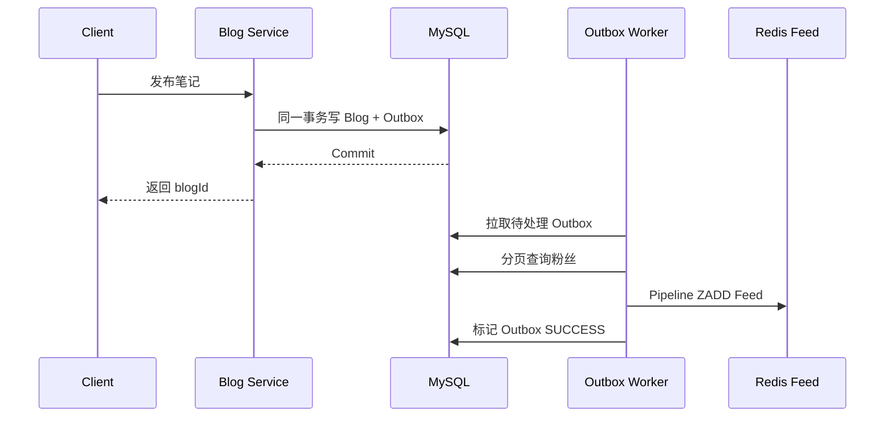
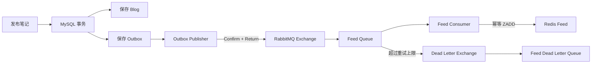

# CitySeek 投递前改造方案

> **状态：核心方案已实现，真实容器验收待完成。**
>
> DTO、GEO 提交后同步、RBAC/图片所有权、Stream 指标和 Feed MySQL Outbox 已落地，并补充了
> 增量 SQL 与自动化测试。2026-07-30 执行 `mvn test` 时非容器测试全部通过；当前机器 Docker
> 不可用，Testcontainers 用例被跳过，因此第 11 节仍保留真实依赖验收项。第 7.10 节 RabbitMQ
> 是可选 P2 扩展，本轮未引入，不能描述为已经实现。

## 1. 目标与范围

本文档针对 CitySeek 当前代码中的五项重点问题制定可执行方案：

1. 修复商铺修改类型或坐标后的 Redis GEO 残留；
2. 增加管理员权限与图片删除所有权控制；
3. 使用请求 DTO 替换 `Shop`、`Blog`、`Voucher` 实体直接入参；
4. 增加 Redis Stream Pending、重试和 DLQ 监控；
5. 将 Feed 发布改造成 MySQL 事务 Outbox + Redis 幂等投递，并提供 RabbitMQ 可靠传输扩展。

本轮改造不以一次性生产化为目标，而是要求：

- 每项修改有明确的问题背景和设计取舍；
- 数据库结构、代码、测试和文档同步更新；
- 保持现有前端接口尽量兼容；
- 能够通过单元测试与 Testcontainers 集成测试证明关键不变量；
- 每项改造形成独立、真实、可回滚的 Git 提交。

## 2. 总体实施顺序

| 阶段 | 改造项 | 优先级 | 预计时间 | 主要价值 |
| --- | --- | --- | ---: | --- |
| 1 | 请求 DTO 与校验 | P0 | 1～2 天 | 收紧接口边界，为后续权限与业务校验打基础 |
| 2 | 商铺 GEO 残留修复 | P0 | 1 天 | 修复明确的功能错误 |
| 3 | 管理员权限与图片所有权 | P0 | 2～3 天 | 修复越权操作风险 |
| 4 | Stream 可观测性 | P1 | 2～3 天 | 展示可靠性链路的运行状态 |
| 5 | Feed Outbox 一致性改造 | P1 | 3～5 天 | 解决同步写扩散和部分投递问题 |
| 6 | RabbitMQ Feed 事件传输 | P2 | 3～4 天 | 展示 Outbox、可靠发布、ACK、重试和 DLQ |

不引入 RabbitMQ 时，推荐总工期为 10～14 个有效开发日；完成 RabbitMQ 扩展时，推荐预留 13～18 个有效开发日。

## 3. 方案一：请求 DTO 与统一校验

### 3.1 当前问题

当前多个 Controller 直接接收数据库实体：

```java
public Result saveShop(@RequestBody Shop shop)
public Result updateShop(@RequestBody Shop shop)
public Result saveBlog(@RequestBody Blog blog)
public Result addVoucher(@RequestBody Voucher voucher)
```

客户端可以提交本不应由客户端控制的字段，例如：

- `id`
- `userId`
- `liked`
- `comments`
- `status`
- `createTime`
- `updateTime`

同时，部分参数校验散落在 Service 中，错误响应也不统一。

### 3.2 新增 DTO

建议增加以下类型：

```text
dto/request/
├─ ShopCreateRequest.java
├─ ShopUpdateRequest.java
├─ BlogCreateRequest.java
├─ VoucherCreateRequest.java
└─ SeckillVoucherCreateRequest.java
```

建议字段如下。

#### `ShopCreateRequest`

```java
@NotBlank
@Size(max = 128)
private String name;

@NotNull
private Long typeId;

@NotBlank
@Size(max = 1024)
private String images;

@NotBlank
@Size(max = 255)
private String address;

@NotNull
@DecimalMin("-180.0")
@DecimalMax("180.0")
private Double x;

@NotNull
@DecimalMin("-90.0")
@DecimalMax("90.0")
private Double y;
```

`x`、`y` 按全球合法经纬度设计，因此数据库列必须允许负数。现有 `tb_shop.x/y` 使用
`UNSIGNED`，实施 DTO 前先执行独立迁移，将它们改成有符号 `DOUBLE NOT NULL`。

`sold`、`comments` 和 `score` 是系统统计字段，不进入创建请求。创建商铺时由服务端统一初始化为
`0`；数据库同时增加 `DEFAULT 0` 作为兜底。`score = 0` 表示暂未产生评分，有评分后的合法范围为
`10～50`。

#### `ShopUpdateRequest`

必须包含 `id`。只开放允许修改的字段，不允许客户端修改销量、评论数、创建时间等系统字段。

#### `BlogCreateRequest`

只接收：

- `shopId`
- `title`
- `images`
- `content`

`userId` 必须从 `UserHolder` 获取，`liked` 和 `comments` 由服务端初始化。

#### `VoucherCreateRequest`

用于普通券，只接收商铺、标题、规则、金额等业务字段。

#### `SeckillVoucherCreateRequest`

在普通券字段基础上增加：

- `stock`
- `beginTime`
- `endTime`

校验规则：

- 库存大于 0；
- 开始时间早于结束时间；
- `payValue`、`actualValue` 大于 0；
- 秒杀券类型由服务端设置，不能相信客户端传入值。

### 3.3 映射方式

当前项目规模较小，第一阶段使用显式手工映射，不立即引入 MapStruct：

```java
// 仅用于创建商铺；更新映射不能重置系统统计字段
Shop shop = new Shop()
        .setName(request.getName().trim())
        .setTypeId(request.getTypeId())
        .setImages(request.getImages())
        .setAddress(request.getAddress().trim())
        .setX(request.getX())
        .setY(request.getY())
        .setSold(0)
        .setComments(0)
        .setScore(0);
```

显式映射能够清楚展示哪些字段允许从外部进入领域模型。

对应数据库迁移：

```sql
ALTER TABLE tb_shop
    MODIFY COLUMN x double NOT NULL COMMENT '经度，-180～180',
    MODIFY COLUMN y double NOT NULL COMMENT '纬度，-90～90',
    MODIFY COLUMN sold int UNSIGNED NOT NULL DEFAULT 0 COMMENT '销量',
    MODIFY COLUMN comments int UNSIGNED NOT NULL DEFAULT 0 COMMENT '评论数量',
    MODIFY COLUMN score int UNSIGNED NOT NULL DEFAULT 0
        COMMENT '评分乘10保存；0表示暂无评分，正常范围10～50';
```

不要只修改最终初始化脚本；该 SQL 应保存为独立迁移，并由 Testcontainers 使用同一迁移验证。

### 3.4 异常与响应

补充异常类型：

```text
exception/
├─ BusinessException.java
├─ ForbiddenException.java
└─ ResourceNotFoundException.java
```

统一映射：

| 异常 | HTTP 状态 |
| --- | ---: |
| 参数校验失败 | 400 |
| 未登录 | 401 |
| 权限不足 | 403 |
| 资源不存在 | 404 |
| 业务冲突，如重复下单 | 409 |
| 未处理异常 | 500 |

可以暂时保留现有 `Result` JSON 结构，但建议将其改成泛型 `Result<T>`。

### 3.5 测试

- 非法经纬度返回 400；
- 客户端提交 `liked`、`comments` 等字段时无法影响数据库；
- 秒杀开始时间晚于结束时间返回 400；
- 标题、内容、图片字段长度与数据库约束一致；
- Service 映射后系统字段由服务端赋值；
- 新建商铺未传 `sold`、`comments`、`score` 时可以成功保存且三者均为 0；
- 西经或南纬的合法坐标可以通过校验并写入数据库。

### 3.6 验收标准

- 写接口不再直接接收数据库实体；
- 所有新增 DTO 使用 `@Valid`；
- 参数错误不再被统一处理成 HTTP 500；
- DTO 约束与数据库有符号范围、非空字段和默认值保持一致；
- 前端现有正常请求保持兼容。

## 4. 方案二：修复商铺 GEO 残留

### 4.1 当前问题

商铺更新后，当前实现只向新的 GEO Key 写入：

```text
shop:geo:{newTypeId}
```

如果类型发生变化，没有从以下旧 Key 删除：

```text
shop:geo:{oldTypeId}
```

如果坐标变化，也需要确保新坐标覆盖成功。数据库成功但 Redis 更新失败时，还需要具备修复能力。

### 4.2 最小正确实现

更新数据库前读取旧值：

```java
Shop beforeUpdate = getById(request.getId());
```

数据库事务提交成功后执行：

1. 删除商铺缓存；
2. 如果类型发生变化，从旧 GEO Key 删除商铺；
3. 向新 GEO Key 写入最新坐标。

伪代码：

```java
redisTemplate.delete(CACHE_SHOP_KEY + shopId);

if (!Objects.equals(oldShop.getTypeId(), newShop.getTypeId())) {
    redisTemplate.opsForGeo().remove(
            SHOP_GEO_KEY + oldShop.getTypeId(),
            shopId.toString()
    );
}

redisTemplate.opsForGeo().add(
        SHOP_GEO_KEY + newShop.getTypeId(),
        new Point(newShop.getX(), newShop.getY()),
        shopId.toString()
);
```

### 4.3 事务边界

Redis 不参与 MySQL 本地事务，不能在事务提交前假设数据库一定成功。

建议发布领域事件：

```java
public record ShopUpdatedEvent(Shop before, Shop after) {}
```

由监听器在事务提交后处理：

```java
@TransactionalEventListener(phase = TransactionPhase.AFTER_COMMIT)
public void onShopUpdated(ShopUpdatedEvent event) {
    shopGeoSynchronizer.synchronize(event.before(), event.after());
}
```

这种方式能够避免数据库最终回滚但 Redis 已更新。不过，进程在事务提交后、事件执行前崩溃时仍可能丢失同步，因此还需要一个轻量级对账任务作为最终修复手段。

### 4.4 对账任务

增加可手工触发或低频执行的 GEO 重建服务：

```text
ShopGeoReconciliationService
```

职责：

- 分页读取商铺；
- 按类型批量构建期望 GEO 数据；
- 使用 Pipeline 写入；
- 输出新增、修复、删除数量；
- 避免在应用启动线程中进行全量逐条初始化。

第一版可以只提供测试环境和管理员手工触发接口，不必立即配置高频定时任务。

### 4.5 集成测试

使用 Testcontainers MySQL + Redis 验证：

1. 商铺最初属于类型 1；
2. Redis 中 `shop:geo:1` 存在该商铺；
3. 将类型修改为 2；
4. 断言 `shop:geo:1` 不再包含该商铺；
5. 断言 `shop:geo:2` 包含该商铺；
6. 断言新 GEO 距离使用更新后的坐标；
7. 断言商铺详情缓存已失效。

额外测试：

- 只修改名称时不重复操作旧 GEO；
- Redis 临时失败后，对账任务能够修复；
- 数据库更新失败时 Redis 保持原状态。

### 4.6 验收标准

- 类型修改后商铺只属于正确的 GEO 分类；
- 坐标修改后附近查询使用最新坐标；
- 数据库回滚不会提前修改 Redis；
- 至少有一个真实 MySQL/Redis 集成测试覆盖类型变化。

## 5. 方案三：管理员权限与图片所有权

### 5.1 权限模型

第一阶段采用简单 RBAC：

| 角色 | 权限 |
| --- | --- |
| `USER` | 登录、资料、关注、点赞、评论、秒杀、上传自己的图片 |
| `ADMIN` | 新增或修改商铺、创建优惠券、管理所有上传图片 |

数据库增加：

```sql
ALTER TABLE tb_user
    ADD COLUMN role varchar(16) NOT NULL DEFAULT 'USER' COMMENT 'USER/ADMIN';
```

同步修改：

- `User`
- `UserDTO`
- 登录 Token Hash
- Token 刷新后的当前用户上下文

### 5.2 权限拦截

为控制改造范围，先延续当前拦截器结构，增加：

```java
@Target({ElementType.METHOD, ElementType.TYPE})
@Retention(RetentionPolicy.RUNTIME)
public @interface RequireRole {
    UserRole value();
}
```

新增 `RoleInterceptor`：

1. 读取 `UserHolder`；
2. 检查目标方法是否存在 `@RequireRole`；
3. 角色不满足时返回 403。

管理员接口标记：

```java
@RequireRole(UserRole.ADMIN)
@PostMapping("/shop")
```

后续如果希望展示 Spring Security，可以将这一套规则迁移到 Spring Security；不建议在同一个提交中同时重写整个登录体系。

### 5.3 图片元数据与所有权

当前上传目录中的文件没有所有权记录。新增表：

```sql
CREATE TABLE tb_upload_file (
    id bigint NOT NULL AUTO_INCREMENT,
    path varchar(512) NOT NULL,
    uploader_id bigint UNSIGNED NOT NULL,
    business_type varchar(32) NOT NULL DEFAULT 'BLOG',
    status tinyint NOT NULL DEFAULT 0 COMMENT '0临时 1已绑定 2已删除',
    create_time timestamp NOT NULL DEFAULT CURRENT_TIMESTAMP,
    update_time timestamp NOT NULL DEFAULT CURRENT_TIMESTAMP
        ON UPDATE CURRENT_TIMESTAMP,
    PRIMARY KEY (id),
    UNIQUE KEY uk_upload_path (path),
    KEY idx_upload_owner (uploader_id, status)
);
```

上传成功后写入：

- 相对路径；
- 当前用户 ID；
- 文件业务类型；
- `TEMPORARY` 状态。

删除规则：

```text
文件上传者本人可以删除未绑定图片；
管理员可以删除任意图片；
普通用户不能删除他人图片；
已经绑定到笔记的图片不能直接物理删除。
```

发布笔记成功后，将引用的图片标记为 `BOUND`。发布前必须验证所有图片都属于当前用户。

### 5.4 文件安全

保留现有路径规范化，并增加：

- 文件后缀白名单；
- MIME 类型初步检查；
- 使用图片解码库验证确实能够读取为图片；
- 服务端重新生成文件名；
- 禁止使用用户原始文件名作为目标路径；
- 删除时先校验数据库所有权，再解析文件路径；
- 文件删除与元数据状态更新失败时记录待清理任务。

### 5.5 测试

- 未登录调用写接口返回 401；
- 普通用户创建商铺或优惠券返回 403；
- 管理员操作成功；
- 用户 A 不能删除用户 B 的图片；
- 用户可以删除自己的临时图片；
- 已绑定图片不能被普通用户直接删除；
- `../` 等目录穿越路径继续被拒绝；
- 假图片后缀文件被拒绝。

### 5.6 验收标准

- 商铺和优惠券管理接口只有管理员可访问；
- 图片删除具有所有权或管理员校验；
- 上传文件可以追踪到用户；
- HTTP 401 与 403 语义明确；
- 权限和所有权均有自动化测试。

## 6. 方案四：Redis Stream 可观测性

### 6.1 依赖

增加：

```xml
<dependency>
    <groupId>org.springframework.boot</groupId>
    <artifactId>spring-boot-starter-actuator</artifactId>
</dependency>
<dependency>
    <groupId>io.micrometer</groupId>
    <artifactId>micrometer-registry-prometheus</artifactId>
</dependency>
```

生产环境只公开必要端点：

```yaml
management:
  endpoints:
    web:
      exposure:
        include: health,info,prometheus
```

Actuator 端点必须由内网或管理员权限保护。

### 6.2 业务指标

新增 `VoucherOrderMetrics`，建议指标如下：

| 指标名 | 类型 | 含义 |
| --- | --- | --- |
| `cityseek.seckill.requests` | Counter | 秒杀请求总数 |
| `cityseek.seckill.accepted` | Counter | Lua 受理数 |
| `cityseek.seckill.rejected` | Counter | 按原因拒绝数 |
| `cityseek.order.persisted` | Counter | MySQL 落库成功数 |
| `cityseek.order.retry` | Counter | 消费重试次数 |
| `cityseek.order.compensated` | Counter | 补偿成功数 |
| `cityseek.order.dlq` | Counter | 写入 DLQ 数 |
| `cityseek.order.processing` | Timer | 单条订单处理耗时 |

拒绝原因使用有限标签：

```text
out_of_stock
duplicate
not_started
ended
not_found
```

禁止把 `userId`、`orderId` 作为指标标签，避免产生高基数。

### 6.3 Redis 状态指标

增加一个低频采集器，每 5～10 秒获取：

- `stream.orders` 长度；
- 消费组 Pending 数量；
- 最老 Pending 消息空闲时间；
- `stream.orders.dlq` 长度；
- 消费组 lag；
- 当前消费者数量。

建议 Gauge：

```text
cityseek.redis.stream.length
cityseek.redis.stream.pending
cityseek.redis.stream.pending.oldest.seconds
cityseek.redis.stream.dlq.length
cityseek.redis.stream.consumer.lag
```

采集失败不能影响订单消费者，只记录警告并保留上一次值。

### 6.4 健康检查

新增 `VoucherOrderStreamHealthIndicator`：

| 状态 | 条件示例 |
| --- | --- |
| `UP` | Redis 可访问，Pending 与 DLQ 在正常范围 |
| `DEGRADED` | Pending 最老时间超过阈值，或 DLQ 非空 |
| `DOWN` | 无法访问 Redis 或消费组不存在 |

如果 Spring Boot Health 不接受自定义 `DEGRADED` 作为默认状态，可使用 `OUT_OF_SERVICE`，并在 details 中提供原因。

### 6.5 告警建议

- DLQ 长度大于 0：警告；
- Pending 最老空闲时间大于 60 秒：警告；
- Pending 持续增长 5 分钟：严重；
- 接受订单数与落库订单数差值持续扩大：严重；
- 消费重试率突增：警告；
- 主 Stream 长度超过配置阈值：警告。

### 6.6 Stream 清理

不要简单按固定长度直接裁剪主 Stream，因为可能删除尚未 ACK 的 Pending 消息。

安全策略：

1. 获取消费组中最小未确认消息 ID；
2. 只清理早于安全水位且已经完成消费的历史消息；
3. 清理操作低频执行；
4. 清理前后记录 Stream 长度；
5. 清理失败不影响主消费链路。

第一阶段可以只监控和告警，不立即启用自动清理；待集成测试证明安全后再开启。

### 6.7 测试

- 正常订单增加 accepted 和 persisted 指标；
- 库存不足增加 rejected 指标并带正确原因；
- 注入数据库失败后 retry 指标增加；
- 达到重试上限后 compensated 和 dlq 指标增加；
- 制造 Pending 消息后 Gauge 能读取正确数量；
- Redis 指标采集失败不影响订单消费。

### 6.8 验收标准

- `/actuator/prometheus` 可以看到秒杀和 Stream 指标；
- 可以从指标区分“请求被拒绝”和“异步落库失败”；
- Pending、DLQ 和消费延迟有明确阈值；
- 指标采集不会阻塞订单消费者；
- 关键指标有测试或故障注入记录。

## 7. 方案五：Feed 事务 Outbox 一致性改造

### 7.1 当前问题

当前发布笔记的流程是：

1. 写入 `tb_blog`；
2. 同步查询全部粉丝；
3. 在 HTTP 请求线程中逐个执行 Redis `ZADD`。

问题：

- 写 MySQL 成功、写 Redis 失败时，部分粉丝收不到动态；
- 大量粉丝导致发布接口响应时间线性增长；
- 中途失败时已经写入的 Feed 无法回滚；
- 没有重试、投递状态和审计记录。

### 7.2 目标流程



核心保证：

- Blog 和 Outbox 在同一个 MySQL 事务提交；
- 只要 Blog 存在，就一定存在可重试的投递任务；
- Redis `ZADD` 以 blogId 为 member，天然支持幂等重放；
- Feed 投递失败不阻塞发布接口。

### 7.3 Outbox 表

```sql
CREATE TABLE tb_outbox_event (
    id bigint NOT NULL,
    aggregate_type varchar(32) NOT NULL,
    aggregate_id bigint NOT NULL,
    event_type varchar(64) NOT NULL,
    payload varchar(2048) NOT NULL,
    status varchar(16) NOT NULL DEFAULT 'PENDING',
    retry_count int NOT NULL DEFAULT 0,
    next_retry_time timestamp NULL DEFAULT NULL,
    error_message varchar(512) NULL,
    claimed_by varchar(128) NULL,
    claim_token varchar(64) NULL,
    processing_deadline timestamp NULL DEFAULT NULL,
    create_time timestamp NOT NULL DEFAULT CURRENT_TIMESTAMP,
    update_time timestamp NOT NULL DEFAULT CURRENT_TIMESTAMP
        ON UPDATE CURRENT_TIMESTAMP,
    PRIMARY KEY (id),
    KEY idx_outbox_pending (
        status,
        next_retry_time,
        create_time
    ),
    KEY idx_outbox_processing (
        status,
        processing_deadline,
        create_time
    )
);
```

`claimed_by` 用于审计当前领取实例，`claim_token` 是每次领取生成的唯一 fencing token，
`processing_deadline` 是处理租约截止时间。直接写 Redis 的 Worker 和后续 RabbitMQ Publisher
都必须复用这套租约规则。它们用于恢复“任务已经改成 `PROCESSING`，但执行实例在投递完成前宕机”
的情况，不能省略。完成、失败和续租操作都必须携带本次 `claim_token`；条件更新影响行数为 0 时，
说明租约已经丢失，旧执行者必须停止更新状态。

事件示例：

```json
{
  "blogId": 10001,
  "authorId": 25,
  "publishedAt": 1785330000000
}
```

### 7.4 发布事务

`saveBlog()` 增加 `@Transactional`：

```java
@Transactional
public Result saveBlog(BlogCreateRequest request) {
    Blog blog = createBlog(request, UserHolder.getUser());
    saveBlogOrThrow(blog);
    outboxEventService.createBlogPublishedEvent(blog);
    return Result.ok(blog.getId());
}
```

事务内只写 MySQL，不直接写 Redis Feed。

### 7.5 Outbox Worker

新增：

```text
feed/
├─ FeedOutboxWorker.java
├─ FeedEventDispatcher.java
└─ FeedDeliveryProperties.java
```

处理步骤：

1. 批量领取已到达重试时间的 `PENDING`，或租约已经过期的 `PROCESSING` 事件；
2. 重新领取过期 `PROCESSING` 时增加 `retry_count`；达到上限则直接标记 `FAILED`；
3. 在同一个短事务内写入 `PROCESSING`、唯一 `claim_token`、`claimed_by` 和新的租约截止时间；
4. 按主键分页查询粉丝，避免一次性加载全部数据；
5. 使用 Redis Pipeline 批量执行 `ZADD`；
6. 处理时间可能超过租约时，使用 `id + claim_token` 条件更新续租；
7. 全部完成后用 `id + claim_token` 条件更新为 `SUCCESS`，并清空领取和租约字段；
8. 可重试失败时增加 `retry_count`、记录摘要、恢复为 `PENDING`、设置指数退避时间并清空租约；
9. 超过重试上限时标记 `FAILED`、清空租约并告警。

多实例下需要安全领取任务。MySQL 8 可以使用：

```sql
SELECT ...
FROM tb_outbox_event
WHERE (
        status = 'PENDING'
        AND (next_retry_time IS NULL OR next_retry_time <= NOW())
      )
   OR (
        status = 'PROCESSING'
        AND processing_deadline <= NOW()
      )
ORDER BY create_time
LIMIT ?
FOR UPDATE SKIP LOCKED;
```

领取查询、重试次数处理、`PROCESSING` 状态更新和租约写入必须在同一个短事务内完成；提交后再执行
Redis 投递，网络操作期间不持有数据库锁。Worker 宕机后，其他实例会在租约到期后重新领取任务；
Redis `ZADD` 的幂等性保证从头重放安全。旧 Worker 即使恢复，也只能执行
`WHERE id = ? AND status = 'PROCESSING' AND claim_token = ?` 的条件更新，不能覆盖新租约持有者的
处理结果。

### 7.6 幂等性

Feed Key：

```text
feed:{followerUserId}
```

member 使用唯一的 `blogId`，score 使用发布时间：

```text
ZADD feed:{userId} publishedAt blogId
```

同一事件重复执行时：

- 不会生成重复 member；
- score 相同；
- 已投递用户不会出现重复 Feed；
- 可以安全地从头重放整个事件。

### 7.7 失败语义

需要明确区分：

- Blog 发布成功：MySQL 中 Blog 与 Outbox 已提交；
- Feed 投递中：用户可以查看作者主页，但部分粉丝 Feed 尚未更新；
- Feed 投递失败：不删除已发布 Blog，由 Outbox 重试；
- Outbox 最终失败：告警并提供管理员重放能力。

这是一种最终一致性设计，不保证发布接口返回时所有粉丝已经看到动态。

### 7.8 测试

#### 事务测试

- Blog 保存失败时不产生 Outbox；
- Outbox 保存失败时 Blog 事务回滚；
- Blog 与 Outbox 必须同时存在。

#### 幂等测试

- 同一 Outbox 执行两次，Feed 中只有一个 blogId；
- 第一次投递部分成功后重试，最终所有粉丝都收到且不重复。

#### 故障测试

- Redis 不可用时 Outbox 进入重试；
- Redis 恢复后事件最终变为 `SUCCESS`；
- Worker 领取任务后宕机，租约到期后任务能够被其他实例重新领取；
- 原 Worker 在租约失效后恢复时，不能覆盖新租约持有者写入的处理结果；
- 达到最大重试次数后变为 `FAILED`；
- 大量粉丝使用分页和 Pipeline，不在内存中一次性加载。

### 7.9 验收标准

- 发布笔记的 HTTP 延迟不再随粉丝数线性增加；
- Blog 和 Outbox 保持同事务；
- Redis 短暂故障后 Feed 可以自动恢复；
- 重复投递不会产生重复动态；
- Outbox 状态、重试次数和失败原因可查询；
- 过期的 `PROCESSING` 任务可以自动恢复，不会永久卡住；
- 至少有一个 Testcontainers 故障恢复测试。

### 7.10 RabbitMQ 可靠传输扩展

#### 7.10.1 定位与取舍

RabbitMQ 不替换秒杀链路中的 Redis Stream。

秒杀 Lua 当前可以在同一个 Redis 原子操作内完成库存校验、预扣库存、一人一单、订单状态和 `XADD`。如果改成 Lua 执行完以后再由 Java 发送 RabbitMQ，会产生下面的跨系统窗口：

```text
Redis 预扣库存成功
→ 应用进程宕机
→ RabbitMQ 消息没有发送
```

Publisher Confirm 只能确认 RabbitMQ Broker 是否接管消息，无法让 Redis Lua 与 RabbitMQ 发布成为一个原子事务。因此项目保留：

```text
秒杀：Redis Lua + Redis Stream
Feed：MySQL Outbox + RabbitMQ + Redis ZSet
```

RabbitMQ 用于 Feed 更合理，因为 Blog 和 Outbox 可以在同一个 MySQL 本地事务中提交，Outbox 再负责跨系统可靠发布。

#### 7.10.2 目标架构



完整流程：

1. 用户发布笔记；
2. 在同一个 MySQL 事务中保存 Blog 和 `BLOG_PUBLISHED` Outbox；
3. HTTP 请求返回 blogId，不等待全部粉丝 Feed 写入；
4. Outbox Publisher 定时领取待发送事件；
5. Publisher 将事件发送到 RabbitMQ Exchange；
6. Confirm 成功且消息正确路由后，将 Outbox 标记为 `PUBLISHED`；
7. Feed Consumer 接收事件并分页查询作者粉丝；
8. 使用 Redis Pipeline 对粉丝 Feed 执行幂等 `ZADD`；
9. Redis 写入全部成功后手动 ACK；
10. 消费失败时有限重试，超过上限进入 DLQ。

#### 7.10.3 RabbitMQ 拓扑

推荐使用持久化 Topic Exchange，为通知、统计等独立消费者保留扩展能力：

| 类型 | 名称 | 用途 |
| --- | --- | --- |
| Topic Exchange | `cityseek.events.exchange` | 接收领域事件 |
| Queue | `cityseek.feed.queue` | Feed 投递 |
| Routing Key | `blog.published` | 笔记发布事件 |
| Dead Letter Exchange | `cityseek.events.dlx` | 接收最终失败事件 |
| Dead Letter Queue | `cityseek.feed.dlq` | 保存 Feed 最终失败消息 |
| DLQ Routing Key | `blog.published.failed` | Feed 死信路由 |

增加 Spring AMQP：

```xml
<dependency>
    <groupId>org.springframework.boot</groupId>
    <artifactId>spring-boot-starter-amqp</artifactId>
</dependency>
```

建议配置：

```yaml
spring:
  rabbitmq:
    host: ${RABBITMQ_HOST:127.0.0.1}
    port: ${RABBITMQ_PORT:5672}
    username: ${RABBITMQ_USERNAME:guest}
    password: ${RABBITMQ_PASSWORD:guest}
    publisher-confirm-type: correlated
    publisher-returns: true
    listener:
      simple:
        acknowledge-mode: manual
        prefetch: 20
```

`RabbitTemplate` 必须启用 `mandatory`。Confirm ACK 表示 Exchange 接管了消息；Return 表示消息无法路由到 Queue。只有 Confirm ACK、没有 Return 且未超时，才能把 Outbox 标记为 `PUBLISHED`。

#### 7.10.4 Outbox Publisher

新增建议：

```text
messaging/
├─ RabbitTopologyConfig.java
├─ OutboxRabbitPublisher.java
├─ BlogPublishedMessage.java
└─ RabbitPublishProperties.java
```

关键规则：

1. 每条消息携带稳定的 `eventId`，并作为 Correlation ID；
2. 使用短事务领取 Outbox，网络发送期间不持有数据库行锁；
3. Confirm NACK、Return、超时或连接异常时，Outbox 保持可重试；
4. 发布失败记录错误摘要，并按指数退避更新 `next_retry_time`；
5. Broker 已收到消息、应用却在更新 Outbox 前宕机时，恢复后允许重复发布；
6. 消费端必须按“至少一次投递”设计，不能假设消息只出现一次。

Outbox 可补充：

```sql
ALTER TABLE tb_outbox_event
    ADD COLUMN published_time timestamp NULL,
    ADD COLUMN correlation_id varchar(64) NULL,
    ADD UNIQUE KEY uk_outbox_correlation (correlation_id);
```

#### 7.10.5 Feed Consumer、幂等与 ACK

消费者收到消息后分页查询粉丝，并通过 Pipeline 写入：

```text
ZADD feed:{followerId} publishedAt blogId
```

`blogId` 是 ZSet member。同一个 blogId 重复执行 `ZADD` 不会生成第二条 Feed，因此以下情况可以安全重试：

- RabbitMQ 重复投递；
- Redis 写成功但 ACK 丢失；
- 只给部分粉丝写入后进程宕机；
- Outbox 已发布但状态更新前进程宕机。

只有全部 Redis Feed 写入成功后才手动 ACK。失败时禁止无限 `requeue=true`，否则会形成重试风暴。

建议重试节奏：

```text
首次失败
→ 1 秒后重试
→ 5 秒后重试
→ 30 秒后重试
→ 进入 cityseek.feed.dlq
```

DLQ 必须保留原始 `eventId`、业务字段、错误摘要和失败时间，并提供监控与管理员重放能力。重放继续使用原 eventId，保持消费幂等。

#### 7.10.6 关键异常场景

| 异常位置 | 结果 | 恢复方式 |
| --- | --- | --- |
| Blog 保存成功、Outbox 保存失败 | Blog 不应单独存在 | 同一 MySQL 事务回滚 |
| RabbitMQ 不可用 | Outbox 保持待发送 | Publisher 延迟重试 |
| Exchange 收到但无法路由 | 触发 Return | 不标记 PUBLISHED，修复拓扑后重试 |
| Broker 收到、Outbox 状态未更新时宕机 | 可能重复发布 | Consumer 幂等 |
| Redis 写入前失败 | 消息不 ACK | 有限重试 |
| 部分粉丝写入后宕机 | 部分 Feed 已更新 | 整条事件重放，ZADD 幂等 |
| Redis 全部写入、ACK 前宕机 | RabbitMQ 重新投递 | ZADD 幂等后再次 ACK |
| 连续消费失败 | 不再无限重试 | 转入 DLQ、告警、人工重放 |

#### 7.10.7 多消费者扩展

同一个 `blog.published` 事件可以绑定多个独立 Queue：

```text
cityseek.feed.queue          → 更新粉丝 Feed
cityseek.notification.queue  → 发送站内通知
cityseek.analytics.queue     → 统计发布行为
```

每个 Queue 独立消费、独立 ACK、独立失败。通知或统计系统故障不会阻塞 Feed，这才是引入 RabbitMQ 的主要价值，而不是单纯增加一个简历关键词。

#### 7.10.8 测试与验收

使用 Testcontainers RabbitMQ + MySQL + Redis 验证：

1. Blog 和 Outbox 同事务提交或回滚；
2. Confirm 成功后 Outbox 变为 `PUBLISHED`；
3. 不存在的 Routing Key 会触发 Return，Outbox 不标记成功；
4. RabbitMQ 暂时不可用，恢复后 Outbox 能成功发布；
5. 相同 eventId 重复发布，Feed 中只有一个 blogId；
6. Redis 写成功但不 ACK，重新投递后仍不重复；
7. Redis 连续失败达到上限后消息进入 DLQ；
8. DLQ 消息可以查询、告警并人工重放；
9. 通知消费者失败不影响 Feed 消费者；
10. 秒杀仍使用 Redis Stream，不形成两套重复订单链路。

#### 7.10.9 面试表达

只有实际完成后，才能将下面内容表述为个人实现：

> 秒杀链路保留 Redis Stream，因为 Lua 可以原子完成库存预占、购买标记和订单消息写入，避免 Redis 与外部 Broker 的双写窗口。Feed 发布链路使用 MySQL 事务 Outbox 和 RabbitMQ：Blog 与 Outbox 同事务提交，后台 Publisher 通过 Confirm 和 Return 保证可靠发布，消费者在 Redis 幂等 ZADD 成功后手动 ACK，有限重试后进入 DLQ。这样既解决了发布笔记时同步遍历粉丝造成的延迟，也能在 RabbitMQ、Redis 或消费者短暂故障后恢复。

继续追问时需要能够解释：

- 为什么不能在保存 Blog 后直接调用 `RabbitTemplate`；
- Confirm 与 Return 的区别；
- 为什么 Confirm 成功后仍可能重复发布；
- Redis 成功但 ACK 丢失后为什么不会产生重复 Feed；
- 为什么秒杀不直接替换成 RabbitMQ；
- Outbox、RabbitMQ、Redis 分别解决哪一段可靠性问题。
## 8. 数据库迁移建议

当前项目使用单一初始化 SQL。建议引入 Flyway：

```text
src/main/resources/db/migration/
├─ V1__baseline.sql
├─ V2__align_shop_constraints.sql
├─ V3__add_user_role.sql
├─ V4__create_upload_file.sql
└─ V5__create_outbox_event.sql
```

注意：

- 不要直接修改已经在其他环境执行过的历史迁移；
- 初始化演示数据与结构迁移分离；
- Testcontainers 使用与生产相同的迁移文件；
- 每次迁移都提供回滚说明，即使 Flyway Community 默认不自动执行回滚。

如果本轮暂不引入 Flyway，至少将新增 SQL 单独保存，避免只修改最终版 `cityseek.sql` 而无法说明升级过程。

## 9. 推荐测试矩阵

| 模块 | 单元测试 | MySQL 集成 | Redis 集成 | HTTP 集成 | 故障注入 |
| --- | :---: | :---: | :---: | :---: | :---: |
| 请求 DTO | 是 | 否 | 否 | 是 | 否 |
| GEO 更新 | 是 | 是 | 是 | 可选 | 是 |
| RBAC | 是 | 可选 | 是 | 是 | 否 |
| 图片所有权 | 是 | 是 | 否 | 是 | 是 |
| Stream 指标 | 是 | 否 | 是 | 可选 | 是 |
| Feed Outbox | 是 | 是 | 是 | 是 | 是 |
| RabbitMQ Feed | 是 | 是 | 是 | 是 | 是 |

执行建议：

```bash
mvn -Dtest='*Test' test
mvn -Dtest=ShopGeoIntegrationTest test
mvn -Dtest=AuthorizationIntegrationTest test
mvn -Dtest=FeedOutboxIntegrationTest test
mvn -Dtest=VoucherOrderReliabilityIntegrationTest test
```

## 10. 建议提交拆分

不要把全部改造压成一个提交。建议真实开发过程中按以下顺序提交：

```text
refactor: introduce validated request DTOs
fix: remove stale shop GEO entries after type changes
test: cover shop GEO synchronization with containers
feat: add role-based administration authorization
feat: track upload ownership and protect deletion
feat: expose voucher stream reliability metrics
feat: publish blog feed through transactional outbox
test: verify feed outbox retry and idempotency
docs: document consistency and failure recovery design
```

提交信息只是建议，实际提交必须与真实完成的改动一致，不应伪造开发历史。

## 11. 最终验收清单

### 功能

- [x] 商铺类型修改后旧 GEO 数据被删除；
- [x] 普通用户不能管理商铺和优惠券；
- [x] 用户不能删除他人的图片；
- [x] 写接口不直接接收数据库实体；
- [x] Feed 可以在 Redis 故障恢复后自动补投。

### 一致性

- [x] 数据库回滚不会提前修改 GEO；
- [x] Blog 与 Outbox 同时提交或同时回滚；
- [x] Feed 重复投递保持幂等；
- [x] Worker 宕机后，过期的 `PROCESSING` Outbox 能够被安全重领；
- [x] Outbox 最终失败可查询、可告警、可重放。

### 可观测性

- [x] 可以查看秒杀受理、拒绝、落库、重试、补偿和 DLQ 指标；
- [x] 可以查看 Stream 长度、Pending、最老 Pending 时间和消费 lag；
- [x] 指标采集失败不会影响订单消费；
- [x] Actuator 端点仅允许管理员访问。

### 测试与交付

- [x] 单元测试全部通过；
- [ ] MySQL/Redis Testcontainers 集成测试通过（用例已补齐，当前机器无 Docker，尚未实际通过）；
- [ ] 至少完成 GEO 与 Feed 两组故障场景测试（用例已补齐，等待 Docker 环境执行）；
- [x] 数据库变更有独立迁移脚本；
- [x] README 包含架构、启动、测试和故障恢复说明。

## 12. 面试讲解重点

完成改造后，应能够用以下结构介绍：

1. **问题**：原始实现在哪里可能产生越权、脏 GEO 或 Redis/MySQL 不一致；
2. **约束**：为什么不能使用跨 MySQL/Redis 的普通本地事务解决；
3. **方案**：DTO、RBAC、事务后事件、Outbox、幂等 ZADD 和监控分别承担什么职责；
4. **取舍**：为什么先使用简单 RBAC，而不是一次性重写全部 Spring Security；为什么 Feed 选择最终一致而不是同步强一致；
5. **证据**：哪些单元测试、容器测试和故障注入证明方案有效；
6. **边界**：当前方案仍未解决哪些生产问题，例如多地域、高可用和超大 V 的 Feed 模型。

只有亲自完成并验证的部分才应写入简历。推荐将“GEO 修复 + 权限控制 + Feed Outbox + Stream 可观测性”作为个人改造主线，而不是笼统声称独立完成整个项目。
